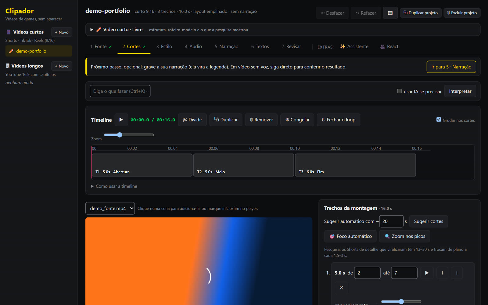
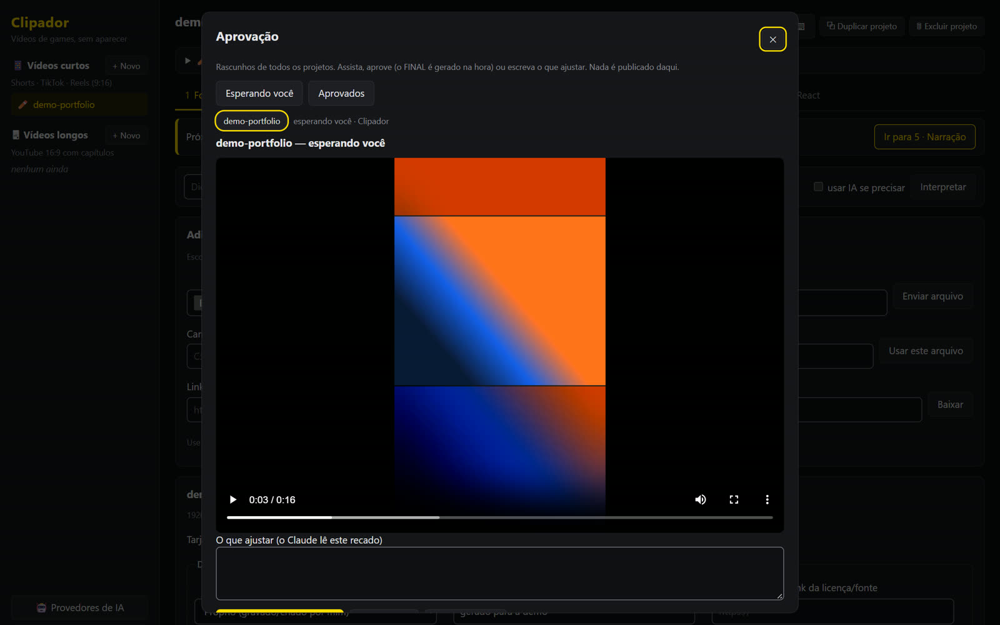
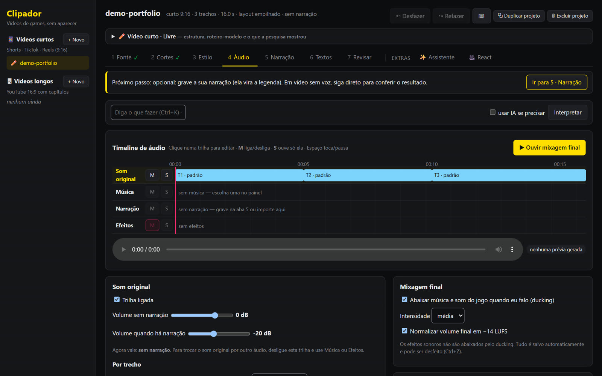
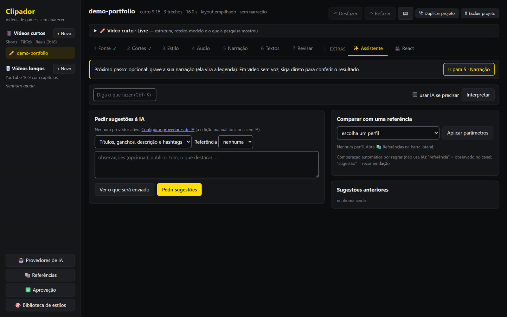
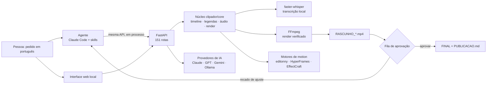

# Clipador — estúdio de vídeo curto operado por agentes de IA

> Um editor de vídeo local que transforma um pedido em português ("faz um Short com os melhores momentos e
> legenda") em um **RASCUNHO pronto para aprovar**: cortes, legenda sincronizada, zoom, mixagem de áudio,
> gráficos animados e texto de publicação por rede. A IA decide e executa; **a pessoa só aprova**.



<sub>Capturas feitas com um projeto de demonstração gerado só para isso (nenhum vídeo de cliente ou de terceiros).</sub>

| | |
|---|---|
| **Problema** | Editar um Short/Reel à mão leva horas: achar o trecho, cortar, legendar palavra por palavra, mixar voz e música, exportar em 9:16, 1:1 e 4:5 e escrever o texto de cada rede. |
| **Solução** | Um app local (FastAPI + JS) com uma API única que serve tanto a interface quanto **agentes de IA** (Claude Code, Claude/GPT/Gemini/Ollama pela API). O agente monta tudo até o RASCUNHO; a pessoa revisa e aprova numa fila. |
| **Construído** | em 2 semanas (16–30/10/2026), com IA como par de programação: **40 módulos de núcleo, 151 rotas de API, 286 testes automatizados**, ~11 mil linhas de Python. |
| **Diferencial** | Guardrails de verdade: nada é publicado sozinho, chaves só no cofre do Windows, a IA nunca escreve texto que a pessoa não falou, e o FINAL é bloqueado no servidor se o vídeo mudou depois da aprovação. |

---

## O que ele faz

1. **Do pedido ao rascunho** — `python -m clipador montar NOME --fonte video.mp4 --pedido "a parte em que ele fala do preço"`
   transcreve a fonte (Whisper local), acha os trechos, monta a timeline, legenda e renderiza o `RASCUNHO_*.mp4`.
2. **Edição de pessoa falando** (Reels empresariais): corta pausas e respirações pela forma de onda, enquadra pelo rosto,
   legenda e coloca **títulos de motion feitos só com as palavras faladas** — o agente nunca inventa texto.
3. **Fila de aprovação** de todos os projetos: assistir → aprovar (gera o FINAL e o `PUBLICACAO.md`) ou
   escrever um recado de ajuste que o agente lê antes de refazer.
4. **Command Center**: comandos em português viram um plano de ações de um catálogo fechado (como ferramentas MCP);
   nada executa sem o clique em *Executar*.
5. **Estúdio de canais** (API + CLI): banco de ideias com pontuação 0–100 de pesos fixos, roteiros com fonte por
   afirmação, esteira de 12 etapas, importação do CSV do YouTube Studio, experimentos A/B (diz "inconclusivo" com
   amostra pequena) e custos por vídeo.
6. **Publicação por rede**: título/descrição/hashtags com os limites de YouTube, TikTok e Instagram, checagem da
   palavra-chave falada + na tela + no texto, versões 1:1, 4:5 (feed do Instagram) e sem áudio.

| Aprovação | Áudio em 4 trilhas | Assistente de IA |
|---|---|---|
|  |  |  |

---

## Como a IA está orquestrada



- **Agentes com instruções versionadas**: [`CLAUDE.md`](CLAUDE.md) é o contrato do agente (regras de legenda, áudio,
  enquadramento, Git e segurança) e [`clipador/docs/GUIA_CODIGO.md`](clipador/docs/GUIA_CODIGO.md) é o mapa por área
  que ele lê antes de mexer. A skill própria [`effectcraft`](.claude/skills/effectcraft/SKILL.md) gera gráficos de motion.
- **Multi-provedor sem prender a um fornecedor** ([`clipador/core/ia/`](clipador/core/ia)): mesma interface para
  Claude (SDK oficial), OpenAI, Gemini e Ollama local; custo por chamada registrado; consentimento por provedor; só
  texto sai da máquina; a sugestão da IA nunca entra no projeto sem clique.
- **Prompt engineering com saída estruturada**: as tarefas do assistente pedem JSON validado e proíbem inventar fatos
  ("se não estiver no material, diga que precisa ser confirmado").
- **Ferramentas em vez de código livre**: o Command Center só deixa a IA escolher ações de um catálogo validado
  ([`core/comandos.py`](clipador/core/comandos.py)), no mesmo espírito de *tools* do MCP.

## Requisitos da vaga AI Builder × onde estão aqui

| A vaga pede | No Clipador |
|---|---|
| Automações que economizam horas reais | Pedido → RASCUNHO sem tocar no editor (`automacao.py`, `editonny_fala.py`, `motion.py`) |
| Ferramentas internas deployadas | App local em `127.0.0.1:8765` com interface, API e atalho de 1 clique |
| Agentes que resolvem problemas de negócio | Agente que edita Reels de empresas (com a skill [SocialmedIA](https://github.com/MateusLacerdaprog/socialmedIA)) e fila de aprovação humana |
| Orquestração de agentes (Claude, GPT, Gemini) | `core/ia/` com os quatro provedores atrás de uma interface só |
| Prompt engineering avançado | Prompts de sistema com regras anti-alucinação, saída JSON, `CLAUDE.md` e skills versionadas |
| APIs sem backend profundo | FastAPI com 151 rotas, validação de toda entrada que vira parâmetro do FFmpeg |
| Análise de dados com IA | Medição de vídeos de referência (cortes, ritmo de fala, loudness) e métricas do CSV do Studio com experimentos |
| Vibe coding | Construído com Claude Code como par, com 286 testes segurando cada mudança |
| Demos construídas do zero em dias | Integração com o editonny, editor por projeto e fila de aprovação saíram no mesmo dia, 19/10 (ver `git log`) |

## Como rodar

Requisitos: **Windows 10/11**, **Python 3.13**, **FFmpeg** no `PATH`. Opcional: Node.js 24 (gráficos do HyperFrames).

```bash
git clone https://github.com/MateusLacerdaprog/clipador.git
cd clipador
python -m pip install -r requirements.txt
python -m clipador                 # abre http://127.0.0.1:8765 (ou dê duplo clique em "Abrir Clipador.bat")
```

Pelo terminal (o mesmo caminho que o agente usa):

```bash
python -m clipador montar meu-short --fonte video.mp4 --trechos 14-20,31-36
python -m clipador finalizar meu-short --narracao voz.wav   # legenda da narração + RASCUNHO novo (nunca FINAL)
python -m clipador ideia listar                             # estúdio de canais
```

Chaves de IA (opcionais) ficam no cofre do Windows, nunca em arquivo: configure em **Provedores de IA** na lateral.

## Qualidade

```bash
python -m pytest tests -q                  # 286 testes, ~12 min (renderiza e transcreve de verdade)
python -m pytest tests -q -m "not lento"   # ciclo rápido, ~100 s
```

- Os testes usam **mídia real gerada pelo FFmpeg**, não mocks, e conferem o arquivo final (duração, trilhas, resolução, loudness).
- `tests/test_qualidade.py` barra import quebrado, função duplicada, rota fora do app e dependência fora do `requirements.txt`.
- `tests/test_interface.py` exige nome acessível e texto ≥ 12 px em todo controle novo.
- Render grava em `.tmp`, confere com `ffprobe` e só então troca o arquivo; FFmpeg parado por 3 min é encerrado.
- `scripts/verificar_terceiros.py` (hook de pre-commit) impede que mídia, dados de clientes ou chaves entrem no Git.

## Estrutura

```
clipador/
  core/        núcleo sem interface: projeto, timeline, legendas, áudio, render, zoom, verificador, aprovação…
  core/ia/     provedores de IA, assistente editorial, custo por chamada
  web/         app.py (segurança + roteadores), rotas/<área>.py, static/ (interface)
  docs/        arquitetura, auditoria, pesquisa e o guia do código
  automacao.py, cli_estudio.py, cli_editonny.py   linha de comando usada pelos agentes
tests/         286 testes (pytest)
.claude/skills/effectcraft/   skill própria de motion graphics
CLAUDE.md      instruções do agente
```

## Documentação

- [Arquitetura](clipador/docs/ARQUITETURA.md) · [Guia do código por área](clipador/docs/GUIA_CODIGO.md) ·
  [Auditoria e plano por fases](clipador/docs/AUDITORIA.md)
- [Integração com o editonny e motion](clipador/docs/EDITONNY.md)
- [Pesquisa de Shorts](clipador/docs/PESQUISA_SHORTS.md) e [formatos virais](clipador/docs/FORMATOS_VIRAIS.md)
- [Estudo de canais com dados (CPV)](clipador/docs/cpv/11-relatorio-final.md): pesquisa, política de monetização,
  protocolo de pontuação, modelo financeiro e manual de operação

## Projeto irmão: SocialmedIA

[**SocialmedIA**](https://github.com/MateusLacerdaprog/socialmedIA) é a skill de agente para **Reels de empresas**:
um playbook medido em 27 Reels virais, regras por nicho (clínica, varejo, indústria, restaurante…), motor de
decisão em Python e portões de qualidade, com 185 testes. O Clipador é o estúdio; a SocialmedIA é o "editor
especialista" que o agente consulta.

## Segurança e limites

- Só aceita conexões do próprio computador e recusa comandos vindos de outros sites.
- Nada é publicado automaticamente; "feito para crianças" e "conteúdo alterado" são declarações da pessoa.
- Sem previsão de views: as notas do app são para priorizar, não promessa de resultado.
- Programas de terceiros (FFmpeg, faster-whisper, editonny, HyperFrames, EffectCraft) são instalados à parte e
  seguem as licenças de cada um.
